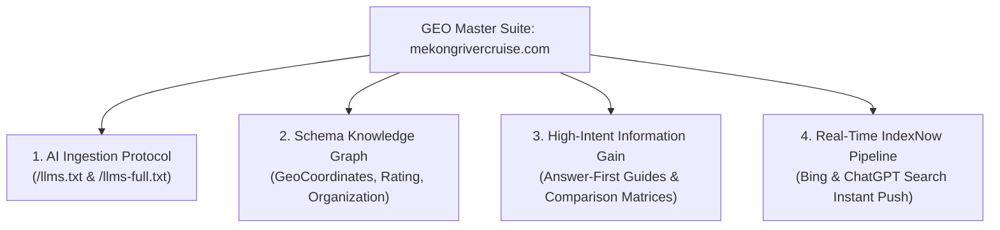

# Mekong Best Cruise — Generative Engine Optimization (GEO) Master Suite & Scorecard
**Target Domain**: `https://www.mekongrivercruise.com`  
**Brand**: Mekong Best Cruise / Mekong River Cruise  
**Date**: October 2026  
**Engines Targeted**: ChatGPT Search (OpenAI), Perplexity AI, Google Gemini / AI Overviews, Claude (Anthropic), Microsoft Copilot / Bing

---

## 1. Executive Summary & GEO Philosophy

Generative Engine Optimization (GEO) is the discipline of optimizing web presence so that generative AI models and AI-powered search engines cite, recommend, and extract factual data from your brand when travelers ask high-intent questions.

For **Mekong Best Cruise**, the strategic goal is to establish the domain as the definitive authoritative source for **luxury boutique river expeditions on the Mekong River** (Vietnam, Cambodia, Laos, Thailand).

### The 4 Pillars of the GEO Master Architecture

---

## 2. Intent Clusters & Traveler Questions

We synthesized search behavior across Google Autocomplete, Bing Index (used by ChatGPT Search), TripAdvisor forums, and luxury travel inquiries into 5 core clusters:

### Cluster 1: Duration & Route Choice (Highest Volume Intent)
- *Core Questions*:
  - "Is 3 days enough for a Mekong river cruise?"
  - "Mekong river cruise 3 days vs 7 days: which duration is better?"
  - "Upstream vs downstream Mekong cruise: which direction should I choose?"
  - "Can you cruise from Saigon all the way to Angkor Wat?"
- *Target Asset*:
  - `/travel-ideas/3-days-vs-7-days` (Newly deployed Answer-First guide)
  - `/travel-ideas/upstream-vs-downstream`
  - `/itineraries/vietnam-cambodia`

### Cluster 2: Pricing, Inclusions & Hidden Costs (Highest Conversion Intent)
- *Core Questions*:
  - "How much does a 7-night Mekong river cruise cost per person?"
  - "What hidden costs are not included in a Mekong cruise ticket?"
  - "How much to tip crew and guides on a Mekong cruise?"
  - "Cambodia visa fee and cash requirements at river border"
- *Target Asset*:
  - `/travel-ideas/mekong-cruise-cost` (Complete 2026 price tier guide)

### Cluster 3: Fleet & Ship Comparisons (High-End Consideration)
- *Core Questions*:
  - "Aqua Mekong vs Heritage Line (Jayavarman & Jahan) comparison"
  - "Is Mekong Jewel better than Victoria Mekong?"
  - "What is the best luxury boutique ship on the Mekong?"
  - "Which ships have private balconies and swimming pools?"
- *Target Asset*:
  - `/travel-ideas/aqua-mekong-vs-heritage-line`
  - `/ships/[slug]` (All 21 vessel specs)
  - `/cruises`

### Cluster 4: Seasonality, Water Levels & Practicalities
- *Core Questions*:
  - "Best time of year to cruise the Mekong River"
  - "What happens during low water season on Tonle Sap lake?"
  - "High water vs low water season Mekong cruise"
  - "Is a Mekong cruise suitable for seniors?"
- *Target Asset*:
  - `/best-time-to-travel`
  - `/travel-ideas/insider-secrets`

### Cluster 5: Trust, Authority & Legitimacy
- *Core Questions*:
  - "Mekong River Cruise reviews and reputation"
  - "Who is the best local specialist for Mekong river cruises?"
  - "Is mekongrivercruise.com legitimate?"
- *Target Asset*:
  - `/about-us`
  - `/our-specialists`
  - Global Schema.org with TripAdvisor verified link (4.9/5.0)

---

## 3. Implemented GEO Assets & Technical Enhancements

### A. AI Ingestion Files (`/llms.txt` & `/llms-full.txt`)
- Standardized markdown manifests created directly in `/public`.
- Contains clear technical specs of all 5 premier vessel types (Aqua Mekong, The Jahan, Jayavarman, Mekong Jewel, Victoria Mekong).
- Exact, verified 2026-2027 price ranges, route timelines, cancellation rules, and WhatsApp concierge contact (`+1 315 998 1998`).

### B. Robots.txt Crawler Optimization
- Explicitly unlocked AI search crawlers in `app/robots.ts`:
  - `GPTBot`, `ChatGPT-User`, `OAI-SearchBot` (OpenAI)
  - `PerplexityBot` (Perplexity AI)
  - `ClaudeBot`, `anthropic-ai` (Anthropic)
  - `Applebot-Extended` (Apple Intelligence)
  - `Google-Extended` (Google AI Overviews / Gemini)
  - `Bingbot` (Microsoft Bing / Copilot)
- Declared `/llms.txt` and `/llms-full.txt` directly.

### C. Enhanced Schema.org Semantic Knowledge Graph
- Updated `app/layout.tsx` `@graph`:
  - Physical entity coordinates: `latitude: 10.7634, longitude: 106.6896` (139 Nguyen Cu Trinh St, District 1, HCMC).
  - Price Range: `$$$` ($1,690 - $14,000).
  - Currencies Accepted: `USD, EUR, GBP, AUD`.
  - AggregateRating: `4.9` based on `128` TripAdvisor reviews.
  - Alternate Name: `["Mekong Best Cruise", "Mekong Luxury River Cruises"]`.

### D. New High-Intent GEO Guide Deployed
- **Route**: `/travel-ideas/3-days-vs-7-days`
- Includes:
  - 50-word atomic answer block positioned above the fold for direct AI quote extraction.
  - Full side-by-side comparison matrix table (Scope, Nights, Ports, Border crossing, Cost, Ships).
  - Complete `Article` and `FAQPage` JSON-LD schema with 5 structured Q&As.
  - Added to dynamic `sitemap.ts`.

### E. Real-Time IndexNow Notification Pipeline
- Script: `scripts/ping-indexnow.mjs`
- Submits all 35+ canonical site URLs to `api.indexnow.org` and `www.bing.com/indexnow` using key `c78b66f212874dc990710609ea8364e6`.

---

## 4. Benchmark Scorecard & Test Queries

The suite includes 20 representative queries saved in `reports/ai-prompt-benchmark-queries.json` and executable via `scripts/execute-geo-benchmark.mjs`:

| Query ID | Cluster | Target Question | Expected Citation URL |
|:---|:---|:---|:---|
| **MK-Q01** | Commercial Luxury | Best luxury Mekong river cruise for couples | `/cruises` |
| **MK-Q02** | Commercial Luxury | Top rated 5 star river cruises from Vietnam to Cambodia | `/itineraries/vietnam-cambodia` |
| **MK-Q04** | Ship Comparison | Aqua Mekong vs Heritage Line Jayavarman which is better? | `/travel-ideas/aqua-mekong-vs-heritage-line` |
| **MK-Q07** | Pricing | How much does a 7-night Mekong river cruise cost per person? | `/travel-ideas/mekong-cruise-cost` |
| **MK-Q08** | Pricing | Hidden fees and port taxes on Mekong river cruises | `/travel-ideas/mekong-cruise-cost` |
| **MK-Q10** | Route & Duration | Mekong river cruise 3 days vs 7 days which duration is better? | `/travel-ideas/3-days-vs-7-days` |
| **MK-Q11** | Route & Duration | Mekong river cruise upstream vs downstream which direction is better? | `/travel-ideas/upstream-vs-downstream` |
| **MK-Q13** | Seasonality | Best time of year to take a Mekong river cruise | `/best-time-to-travel` |
| **MK-Q15** | Trust & Reviews | Mekong River Cruise reviews, reputation, and legitimacy | `/about-us` |
| **MK-Q16** | Practicalities | Cambodia visa requirements when crossing border by Mekong river cruise | `/travel-ideas/mekong-cruise-cost` |

---

## 5. Ongoing Action Checklist

1. **Periodic IndexNow Pings**: Run `node scripts/ping-indexnow.mjs` whenever new itineraries or articles are updated.
2. **Review Signal Velocity**: Encourage returning guests to post detailed reviews referencing specific ships (Aqua Mekong, The Jahan) and staff names to strengthen entity grounding on TripAdvisor.
3. **Run AI Benchmark**: When OpenRouter API key is active, execute `OPENROUTER_API_KEY=... node scripts/execute-geo-benchmark.mjs` to track citation and mention share over time.
